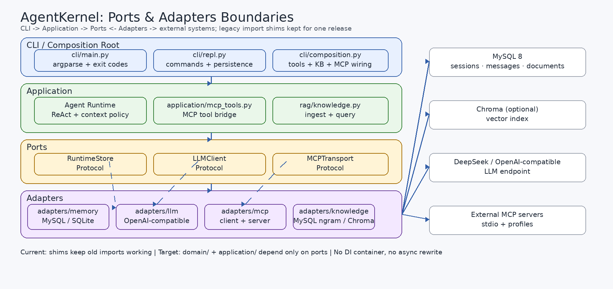

# AgentKernel

> 一个不依赖 Agent 框架、参考公开实现自行实现 ReAct Runtime、Tool Calling、MCP 协议与持久化检索的 **Python CLI 研究原型**；按生产标准建设（门禁、可观测、可回滚、安全边界），但不发布为在线服务。

[](https://github.com/ikun-ikun1/AgentKernel/actions/workflows/ci.yml)
[项目状态](docs/status.md) · [生产问题](docs/production-problems.md) · [生产标准](docs/production-standard.md) · [差距分析](docs/production-standard-gap.md) · [架构 ADR](docs/Addendum/adr-003-production-architecture.md) · [Runbook](docs/runbook.md) · [变更记录](CHANGELOG.md) · [架构图](docs/architecture.png)

## 现状（2026-10-31）

| 维度 | 数字 / 状态 |
|---|---|
| 测试 | **227 个**：本地 `221 passed / 6 skipped`（无 MySQL DSN），CI `226 passed / 1 deselected`（live）/ `0 skipped`；覆盖率 **84.87%**（CI 门槛 80%，核心模块 ≥90%） |
| 评测 | `make eval` → **50/50**（mock）；`make eval-live-p02` → 首轮 **23/24**，澄清 1 条歧义任务后 **24/24**（100% 仅限该任务集，p95 1.77s，$0.006988） |
| 真实模型 | 8 次冒烟 + P0-2 24 条任务；P0-2 成本 $0.006988，累计 < $0.02 |
| CI | GitHub Actions：`test`（MySQL 8 service + 0-skip 强制）、`eval-minimal`、`security`、`docker` |
| 镜像 | 多阶段、非 root（uid 10001）、310MB、体积门禁 < 400MB |
| 数据层 | MySQL 8 为事实源；SQLite 仅测试适配器；Alembic 0001/0002 可往返 |
| 观测 | JSONL 12 核心 + 条件字段（含审批/幂等审计）、trace/span 树、`make report / trace / prune` |

完整状态、未完成项与复现命令见 **[docs/status.md](docs/status.md)**。

## 这个项目在解决/探讨哪些真实生产问题

> 不是「又一个能对话的 Agent demo」。AgentKernel 把 Agent 落地时最容易在生产里翻车的几类问题拆开，逐项实现、测试、评测，并记录残余风险。完整版见 **[docs/production-problems.md](docs/production-problems.md)**。

| # | 真实生产问题 | 典型故障 | 项目里的做法 |
|---|---|---|---|
| P1 | 模型输出不可靠 | 坏 JSON、未知工具、超长 payload、代码围栏 | 提取 → 修复 → 工具名 allowlist → 256KB 上限 → 纯文本降级 |
| P2 | 上下文膨胀 | 早期约束丢失、压缩失败、历史撑爆 | 保留首条要求 → compact 摘要 → 失败 truncate |
| P3 | 多进程写同一会话 | 丢失更新、`updated_at` 回退、1213 死锁 | 会话行锁 `FOR UPDATE` + 有界 LRU + 指数退避（ADR-002） |
| P4 | RAG 新鲜度/降级 | 重复入库、改文档不更新、向量不可用 | SHA-256 增量索引 + MySQL ngram 基线 + 可选向量回退 |
| P5 | MCP/工具边界 | 任意命令、继承 API key、路径穿越 | 命名 profile + 精确 argv + env 白名单 + realpath 文档根 |
| P6 | 观测与成本 | 不知道 token/成本/哪一步慢、日志带密钥 | JSONL 12 核心 + 条件字段 + trace/span + 版本化定价 + 写库前脱敏 |
| P7 | Schema/迁移安全 | `create_all` 与 Alembic 双轨、回滚后表被建回 | Alembic 往返测试 + 备份/恢复演练 + expand/contract |
| P8 | 交付可重复 | 本地能跑 CI 不绿、镜像 root、体积失控 | `uv.lock` + CI 0-skip + 非 root 镜像 + 体积门禁 |

> 面试/评审先看这张表：先讲问题，再讲取舍和证据，最后主动说剩余风险。架构目标与增量重构见 **[ADR-003](docs/Addendum/adr-003-production-architecture.md)**。

## 研究主线

项目不以「能对话的 Agent」为终点，而是「基线实现 → 发现问题 → 针对性优化 → 场景验证」：

1. 复现 ReAct 主循环、工具注册、观察回灌与记忆，建立可解释的 Runtime 基线；
2. 针对模型输出不稳定：分层 JSON 修复、工具名 allowlist、payload 上限、失败降级纯文本；
3. 针对文档重复入库与向量依赖不可用：SHA-256 增量索引、MySQL ngram 持久化基线、可选向量检索与回退；
4. 用 fake LLM、故障输入、文档变更、MCP 子进程与真实 MySQL 验证，而不是只验证成功路径。

## 能力

| 模块 | 说明 |
|---|---|
| Runtime | ReAct 循环、`MAX_STEPS`、单/多工具调用、观察回灌、truncate/compact 上下文策略 |
| Tool Calling | 手写 JSON Schema 子集校验、工具名 allowlist、异常转为可读观察 |
| JSON 修复 | 提取 → 修复 → 降级三层；256KB payload 上限；未知工具不执行 |
| 记忆 | MySQL 会话/消息/工具审计（含 `duration_ms`），SQLite 测试适配器，`/new /sessions /history /logs` |
| 检索 | PDF/MD/TXT 入库、checksum 增量、稳定 chunk id、MySQL ngram、可选 Chroma + RRF |
| MCP | 自实现 client 与只读 server（`initialize → tools/list → tools/call`）；外部 server 走**命名 profile + 精确 argv + env 白名单** |
| 可观测 | 每轮 1 条 `turn`、每次工具 1 条 `tool`；trace/turn/span id；token/成本（定价表版本化）；写库前脱敏 |
| 安全边界 | 无 shell/eval、AST 计算器、文档根 realpath 白名单（拒 symlink 逃逸）、子进程 env 清洗、DSN 脱敏、LLM 出站 allowlist |
| 交付 | `uv.lock`、`make check`、CI（MySQL service）、多阶段 Dockerfile、迁移往返测试 |

## 快速开始

```bash
# 1. 安装（锁定依赖；pdf 是轻量 PDF 解析，rag/mcp 按需）
uv sync --frozen --extra dev --extra mysql --extra pdf

# 2. 一键体检：python/.env/依赖/MySQL/迁移/口令/磁盘（7 项）
make doctor

# 3. 一键检查：ruff + format + mypy + pytest(排除 live) + eval(mock)
make check
# 可选：真实 API 冒烟（1 次调用，约 $0.0002）
AGENTKERNEL_LIVE_API=1 make test-live

# 4. 起 MySQL（本地开发）
docker compose up -d mysql
# 5. 配环境变量（.env，勿提交）
cp .env.example .env   # 填 DEEPSEEK_API_KEY、DSN；按需设 AGENTKERNEL_DOC_ROOTS
# 未配置 DSN 时 CLI 会直接报错（G-06：不再内置默认口令）

# 6. 首次初始化 schema（G-16：只走 Alembic，不再自动建表）
python -m agentkernel --migrate
# 7. 跑 CLI（默认 MySQL；无 MySQL 时用内存库）
python -m agentkernel --kb-backend lexical

# 8. 外部 MCP server：只接受 profile 声明的命令
cp mcp_profiles.example.toml mcp_profiles.toml   # 修改 command / args
python -m agentkernel --mcp-profile kb-server

# 9. 观测与运维
AGENTKERNEL_LOG=~/.agentkernel/logs/agentkernel.jsonl python -m agentkernel
make report       # SLO 周报 → docs/reports/
make trace        # 按 trace_id 打印 span 树
make prune        # 日志 14 天 / DB 90 天（--dry-run 可先看）
make backup       # MySQL 逻辑备份（保留 7 份，口令走 env）
make restore-drill # 恢复最新备份到临时库并校验行数（产报告）
make security     # gitleaks 密钥扫描 + semgrep 本地 SAST（离线）
make audit        # pip-audit 审计 lock 依赖（需网络）
make coverage     # 覆盖率报告（term + coverage.xml）
make eval-live    # golden set 20 条真实调用（需 DEEPSEEK_API_KEY）
```

CLI 内置命令：`/new`、`/sessions`、`/history`、`/ingest <路径>`、`/docs`、`/logs`、`/help`、`/quit`。
> P0-5 起：`/ingest`、`--docs`、MCP server 位置参数只允许 `AGENTKERNEL_DOC_ROOTS` 内的路径（默认当前目录）；`--mcp "任意命令"` 仅在 `AGENTKERNEL_ALLOW_RAW_MCP=1` 时可用。

## 架构



| 模块 | 职责 |
|---|---|
| `runtime/agent.py` | ReAct 主循环 + 上下文策略 + 观测事件 |
| `adapters/llm/openai_compatible.py` | DeepSeek（OpenAI 兼容）调用封装，捕获 usage |
| `tools/` | registry、contracts、json_repair、builtin |
| `memory/` | Store 接口、MySQL 主存储、SQLite 测试适配器 |
| `rag/` | 解析、增量入库、ngram/向量检索、来源元数据 |
| `mcp/` | framing、client、server、profiles（精确 argv + env 白名单） |
| `utils/` | env、errors、observability（JSONL/脱敏/定价）、paths（文档根） |
| `scripts/` | `report.py`（SLO 周报）、`trace.py`（span 树）、`prune.py`（保留期） |

## 目录结构

```text
AgentKernel/
├── Makefile                 # sync / check / report / trace / prune / docker-*
├── Dockerfile               # 多阶段；运行阶段非 root
├── pyproject.toml  uv.lock  .python-version
├── mcp_profiles.example.toml
├── src/agentkernel/         # runtime / tools / memory / rag / mcp / utils
├── migrations/versions/     # 0001 初始 schema、0002 tool_logs.duration_ms
├── scripts/                 # report / trace / prune
├── tests/                   # 227 个测试（含 MySQL 集成、迁移往返、D4 多进程、备份演练、注入隔离）
└── docs/                    # status、production-standard(-gap)、架构、历史里程碑、附录
```

## 边界声明

**要证明什么**：模型只返回文本时，如何解析成工具调用并安全执行；ReAct 循环如何处理观察、失败与步数上限；上下文超限如何 truncate/compact 并降级；MCP 的帧协议与能力协商如何实现；如何用测试、eval 与真实数据库验证上述行为。

**明确不做**：Web/SSE/前端、登录与多租户、人工审批平台、企业审计产品、Agent 插件市场、真实企业系统接入、生产部署编排（K8s/IaC）。详见 [技术边界](docs/technical-scope-and-boundary.md)。

## 文档

| 文档 | 内容 |
|---|---|
| [docs/status.md](docs/status.md) | 当前状态、门禁、未完成项（单一事实源） |
| [docs/production-standard.md](docs/production-standard.md) | 项目级 SLO、错误预算、威胁模型、六门禁阈值、豁免 |
| [docs/production-standard-gap.md](docs/production-standard-gap.md) | 逐项差距、证据、优先级、路线图 |
| [docs/README.md](docs/README.md) | 全部文档索引（含历史里程碑与附录） |

## License

MIT
